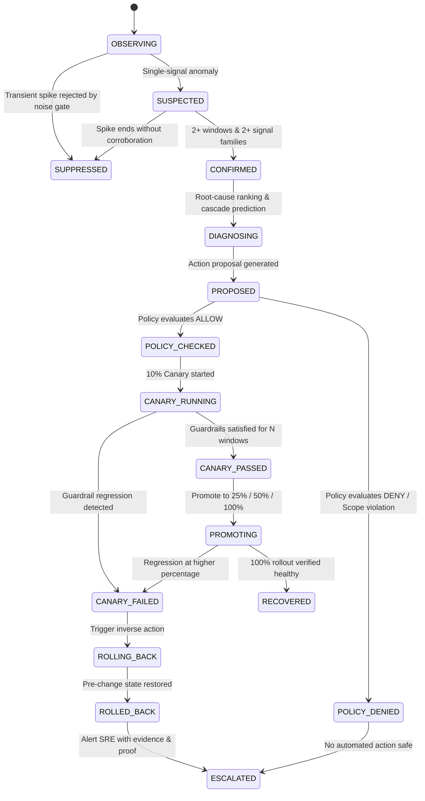

# CivicGuard Autopilot — System Architecture

CivicGuard Autopilot is a proof-carrying self-healing control plane designed for mission-critical Digital Public Infrastructure (DPI). It observes complex distributed services, learns dynamic dependency graphs from trace spans, filters transient noise, computes explainable multi-signal root causes, generates cryptographically signed Remediation Proofs, and enforces safety guardrails via progressive 10% canaries and automated rollback.

---

## 1. High-Level Architectural Flow

```mermaid
flowchart TD
  subgraph Data_Plane["Synthetic DPI Service Mesh (Data Plane)"]
    CP[citizen-portal] --> IS[identity-service]
    CP --> ES[eligibility-service]
    IS --> RA[redis-replica-a]
    IS -.-> RB[redis-replica-b (Canary Target)]
    ES --> BE[benefits-engine]
    ES --> DB[(postgres-db)]
    BE --> PS[payment-service]
    BE --> DB
    PS --> NS[notification-service]
  end

  subgraph Ingestion_Pipeline["Telemetry Ingestion & Graph Discovery"]
    T_Ingest[Telemetry Ingestion Service]
    Span_Proc[Span Processor & Call Graph Reconstructor]
    Aggregator[Sliding-Window Aggregator]
    Live_Graph[(Live Topology Graph / NetworkX)]
  end

  subgraph Detection_Engine["Detection & Noise Gate"]
    Robust_Base[Robust Baseline: Median + MAD]
    Noise_Gate[Noise Gate: Persistence + Multi-Signal Gate]
    Change_Detect[Change-Point & SLO Breach Detector]
  end

  subgraph Diagnosis_Engine["Root-Cause Ranking & Cascade Prediction"]
    RCA[Explainable 6-Factor RCA Ranker]
    Cascade[Reverse-Dependency Multi-Hop Cascade Predictor]
  end

  subgraph Safe_Recovery["Remediation & Guardrails Engine"]
    Proposal[Action Proposal Engine]
    Policy[Deterministic Policy Engine]
    Proof[Remediation Proof Generator]
    Canary[Canary Controller: 10% -> 25% -> 50% -> 100%]
    Rollback[Rollback & Inverse State Restorer]
  end

  subgraph Storage_Audit["Audit & Control Interface"]
    Audit_Ledger[(Tamper-Evident HMAC-SHA256 SQLite Store)]
    FastAPI_Srv[FastAPI Application + WebSockets]
    UI_Console[Melli 3D Landing + Real Control Room Dashboard]
  end

  Data_Plane -->|Metrics, Spans, Logs| T_Ingest
  T_Ingest --> Span_Proc
  T_Ingest --> Aggregator
  Span_Proc --> Live_Graph
  Aggregator --> Robust_Base
  Robust_Base --> Noise_Gate
  Noise_Gate --> Change_Detect
  Change_Detect -->|Confirmed Anomaly Cluster| RCA
  Live_Graph --> RCA
  RCA --> Cascade
  Cascade --> Proposal
  Proposal --> Policy
  Policy --> Proof
  Proof --> Canary
  Canary -->|Guardrail Breach| Rollback
  Canary -->|Step Passed| Canary
  Proof --> Audit_Ledger
  Rollback --> Audit_Ledger
  FastAPI_Srv --> UI_Console
```

---

## 2. Dependency Direction Convention

- **Call Direction (`caller → callee`):** An edge pointing from service $A$ to service $B$ denotes that $A$ calls $B$ (i.e., $A$ depends on $B$).
- **Failure Propagation Direction (`callee → callers`):** When service $B$ (e.g., `redis-replica-a`) fails or degrades, the failure spreads **backwards** along reverse edges to its callers ($A$, then $A$'s callers), propagating outward to the user-facing edge (`citizen-portal`).
- **Graph Reversal Traversal:** CivicGuard explicitly reverses the directed call graph to calculate blast radius and predicted impact paths without confusing causes and effects.

---

## 3. Mathematical Models & Scoring

### 3.1 Robust Anomaly Score
To prevent contamination by occasional outlier spikes, CivicGuard utilizes the Median Absolute Deviation (MAD):
$$z_{\text{robust}} = \frac{x - \text{median}(X)}{\max(1.4826 \times \text{MAD}(X), \epsilon)}$$
where $\text{MAD}(X) = \text{median}(|X - \text{median}(X)|)$.

### 3.2 Change-Point Detection & CUSUM
One-sided cumulative sum for detecting sustained shifts in latency or error rate:
$$C_k^+ = \max(0, C_{k-1}^+ + z_k - \kappa)$$
where $\kappa = 0.5$ is the reference slack parameter.

### 3.3 Root-Cause Ranking (RCA) Heuristic Score
The probable root-cause score $S(n) \in [0, 100]$ for node $n$ is:
$$S(n) = 100 \times \Big( 0.25 \, T(n) + 0.20 \, M(n) + 0.20 \, D(n) + 0.15 \, P(n) + 0.10 \, L(n) + 0.10 \, G(n) \Big)$$
- $T(n)$: Temporal precedence (earlier anomaly onset relative to cluster).
- $M(n)$: Anomaly magnitude (normalized p95 latency and error rate).
- $D(n)$: Downstream caller degradation ratio.
- $P(n)$: Supporting trace span error/latency ratio.
- $L(n)$: Structured error log density.
- $G(n)$: Topological position (callee depth; absence of deeper broken dependencies).

---

## 4. Remediation State Machine



