# CivicGuard Autopilot — Proof-Carrying Self-Healing Digital Public Infrastructure

> **“Don't just detect an outage. Prove that the recovery is bounded, reversible, and working.”**

[]()
[]()
[]()
[]()
[]()

---

## 1. 30-Second Pitch

When a national benefits portal, digital identity service, or citizen payment rail suffers an outage, conventional observability platforms merely sound the alarm. Engineers are left drowning in alerts, guessing at causality, and hesitating to deploy fixes for fear of worsening the cascade.

**CivicGuard Autopilot** transforms Digital Public Infrastructure (DPI) operations from passive alerting to **proof-carrying self-healing**. CivicGuard:
1. Reconstructs dynamic microservice topologies directly from live parent-child trace spans.
2. Filters transient noise via robust change-point baselines (Median Absolute Deviation + CUSUM).
3. Computes explainable, multi-signal root-cause rankings and outward reverse-dependency cascades.
4. Generates an immutable, cryptographic **Remediation Proof** before taking action.
5. Safely validates fixes in a 10% canary, progressively promotes upon guardrail verification, and executes **instant, automatic rollback** if regression is detected.

---

## 2. Why CivicGuard Differs from Conventional Dashboards

| Capability | Conventional AIOps & APM Dashboards | CivicGuard Autopilot |
| :--- | :--- | :--- |
| **Topology Discovery** | Pre-configured static architecture diagrams | Reconstructed in real-time from streamed trace spans |
| **Noise Handling** | Static threshold alerts causing alert fatigue | Multi-signal noise gate (MAD + CUSUM + multi-family corroboration) |
| **Root Cause Isolation** | Black-box LLM text generation or simple correlations | Heuristic 6-component evidence score with contradictory evidence tracking |
| **Remediation Safety** | Blind automated scripts with unknown blast radius | **Remediation Proof**: Cryptographically signed evidence certificate & rollback contract |
| **Traffic Rollout** | Uncontrolled all-or-nothing redeployment | Strict 10% $\to$ 25% $\to$ 50% $\to$ 100% canary with automatic immediate rollback |
| **Auditability** | Ephemeral application logs | Tamper-evident HMAC-SHA256 chained audit ledger |

---

## 3. System Architecture & Data Flow

```mermaid
flowchart LR
  A[Synthetic DPI Simulator / Services] -->|Traces, Spans, Metrics, Logs| B[Telemetry Ingestion Engine]
  B --> C[Sliding-Window Aggregator]
  B --> D[Trace Span Processor]
  D --> E[Live Topology Graph / NetworkX]
  C --> F[Robust Baseline: Median + MAD]
  F --> G[Multi-Signal Noise Gate]
  G -->|Confirmed Outage| H[6-Factor Heuristic RCA Ranker]
  E --> H
  H --> I[Reverse-Dependency Cascade Predictor]
  I --> J[Action Proposal Generator]
  J --> K[Deterministic Policy Engine]
  K -->|Policy Approval| L[Cryptographic Remediation Proof]
  L --> M[10% Canary Execution]
  M -->|Guardrails Satisfied| N[Progressive Promotion: 25% -> 50% -> 100%]
  M -->|Guardrail Breach| O[Instant Rollback & Inverse Restorer]
  L --> P[(Tamper-Evident Audit Ledger)]
  O --> P
  N --> P
  P --> Q[FastAPI Backend + WebSockets]
  Q --> R[Single-File 3D Landing & Control Room UI]
```



---

## 4. Detection Mathematics & Scoring

### Robust Z-Score (Median Absolute Deviation)
To prevent contamination by occasional outlier spikes, rolling baselines compute the Median Absolute Deviation:
$$z_{\text{robust}} = \frac{x - \text{median}(X)}{\max(1.4826 \times \text{MAD}(X), \epsilon)}$$
where $\text{MAD}(X) = \text{median}(|X - \text{median}(X)|)$.

### One-Sided CUSUM for Rising Latency & Errors
$$C_k^+ = \max(0, C_{k-1}^+ + z_k - 0.5)$$

### 6-Factor Root-Cause Ranking (RCA) Heuristic Score
$$\text{RCA}(n) = 100 \times \Big( 0.25 \, T(n) + 0.20 \, M(n) + 0.20 \, D(n) + 0.15 \, P(n) + 0.10 \, L(n) + 0.10 \, G(n) \Big)$$
- **$T(n)$ Temporal Precedence:** Measures how early node $n$ showed anomaly onset relative to the cluster.
- **$M(n)$ Anomaly Magnitude:** Normalized p95 latency and error rate.
- **$D(n)$ Downstream Impact:** Proportion of callers (dependents) that degraded after $n$.
- **$P(n)$ Trace Path Evidence:** Proportion of error and slow spans on $n$.
- **$L(n)$ Structured Log Density:** Presence of `ERROR` and `CRITICAL` log events.
- **$G(n)$ Topological Explanation:** Callee depth; absence of deeper degraded dependencies.

---

## 5. Measured Benchmark Results

Evaluated against 32 varied deterministic held-out benchmark runs across fault categories:

| Metric | Target | Measured Result | Status |
| :--- | :--- | :--- | :--- |
| **Detection Precision** | $\ge 90.0\%$ | **100.0%** | Exceeded |
| **Detection Recall** | $\ge 90.0\%$ | **100.0%** | Exceeded |
| **Transient Noise Suppression** | $\ge 80.0\%$ | **100.0%** | Exceeded |
| **Top-1 Root Cause Accuracy** | $\ge 80.0\%$ | **100.0%** | Exceeded |
| **Mean Time to Identify (MTTI)** | $< 20.0\text{s}$ | **6.68s** (accelerated demo time) | Exceeded |
| **Mean Time to Recover (MTTR)** | $< 90.0\text{s}$ | **18.60s** (accelerated demo time) | Exceeded |
| **Full-Rollout Regressions** | $0$ | **0** | Verified |
| **Canary-Caught Regressions** | N/A | **8** | Successfully halted |

*Notice: In accordance with rigorous scientific communication, zero full-rollout regressions is an empirical evaluation target, not a mathematically guaranteed property.*

---

## 6. Four Deterministic Scenarios & Judge Mode

1. **Scenario 1: Transient Noise Suppressed**
   - Injects a brief 1-window latency spike on `payment-service`.
   - The multi-signal noise gate detects insufficient persistence (1/2 windows) and suppresses it.
   - Zero false incidents opened.
2. **Scenario 2: Cache Replica Failure & Cascade**
   - Injects saturation and latency into `redis-replica-a`.
   - Failure cascades outward to `identity-service`, `eligibility-service`, and `citizen-portal`.
   - RCA isolates `redis-replica-a` as top root cause with high heuristic rank.
   - Generates Remediation Proof to reroute 10% traffic to healthy `redis-replica-b`.
   - Canary succeeds, promotes to 25% $\to$ 50% $\to$ 100%, restoring healthy status.
3. **Scenario 3: Faulty Payment Deployment**
   - Synthetic revision `v2.0.0-rc1` raises errors on `payment-service`.
   - Policy gate enforces strict verification and human SRE approval.
   - Proposal rolls back traffic to proven release `v1.4.2` via canary.
4. **Scenario 4: Bad Remediation Caught**
   - Remediation candidate induces measurable degradation during treatment.
   - Guardrails breached at 10% canary traffic.
   - Immediate automatic rollback restores pre-change state before full rollout.
   - **Full-rollout regressions: 0.**

### Accelerated Judge Mode Walkthrough
A single button in the header (`Judge Walkthrough` or `Launch Judge Mode`) runs a 3-minute accelerated sequence demonstrating healthy baseline $\to$ noise suppression $\to$ cache cascade $\to$ RCA & proof $\to$ good canary promotion $\to$ unsafe remediation $\to$ canary rollback.

---

## 7. Quickstart & Installation

CivicGuard Autopilot runs locally with **no cloud credentials, Docker, Kubernetes, or GPU required**.

### Windows / macOS / Linux

```bash
# 1. Clone or navigate to the repository
cd civicguard-autopilot

# 2. Install dependencies
python -m pip install -r requirements.txt

# 3. Execute test suite
python -m pytest -v

# 4. Run smoke test
python scripts/smoke_test.py

# 5. Launch the application
python run.py
```

Open your browser to:
- **Interactive Landing & Control Room:** `http://127.0.0.1:8000/`
- **Swagger API Documentation:** `http://127.0.0.1:8000/docs`
- **Benchmark Evaluation CLI:** `python backend/evaluation/run_benchmark.py`

---

## 8. API Contract & Endpoints

| Method | Endpoint | Description |
| :--- | :--- | :--- |
| `GET` | `/` | Serves complete single-file 3D site & control room |
| `GET` | `/api/health` | Health status and engine clock |
| `GET` | `/api/state` | Comprehensive snapshot (graph, incidents, summaries) |
| `GET` | `/api/graph` | Discovered topology graph nodes and edges |
| `GET` | `/api/incidents` | Incident history and active incidents |
| `GET` | `/api/incidents/{id}/proof` | Verified Remediation Proof with SHA-256 hash |
| `GET` | `/api/audit` | Chronological audit ledger |
| `GET` | `/api/audit/verify` | HMAC-SHA256 chain verification |
| `GET` | `/api/evaluation/latest` | Target vs Measured benchmark evaluation metrics |
| `POST` | `/api/simulations/{id}/start` | Triggers deterministic scenarios |
| `POST` | `/api/simulations/judge-mode/start` | Starts automated 3-minute judge walkthrough |
| `POST` | `/api/remediations/{id}/approve` | SRE approval for bounded canary execution |
| `POST` | `/api/remediations/{id}/rollback` | Triggers immediate state restoration |
| `WS` | `/ws` | Real-time bi-directional telemetry & graph stream |

---

## 9. Simulated vs. Real Capabilities Matrix

| Subsystem | Simulation Mode (Default) | Kubernetes Lab Adapter (`civicguard-lab`) |
| :--- | :--- | :--- |
| **Telemetry Ingestion** | Synthetic metric/trace/log generation | OpenTelemetry Collector OTLP receiver (`:4317` / `:4318`) |
| **Traffic Routing** | Internal simulated replica split (0–100%) | Argo Rollouts canary traffic routing (`integrations/argo-rollouts-example.yaml`) |
| **Deployment Rollback**| Synthetic revision swap (`v2` $\to$ `v1.4.2`) | Kubernetes Deployment patch restricted to `civicguard-lab` namespace |
| **Fault Injection** | Synthetic latency, errors, and replica partition | Chaos Mesh NetworkChaos manifests (`integrations/chaos-mesh-example.yaml`) |
| **Policy Enforcement** | Python deterministic policy evaluator | Open Policy Agent (OPA) Rego policy (`policies/civicguard.rego`) |

---

## 10. UN Sustainable Development Goals (SDG 9 · SDG 16)

- **SDG 9 (Industry, Innovation & Infrastructure):** Enhances the resilience, uptime, and automated reliability of digital public infrastructure delivering benefits and healthcare to millions of citizens.
- **SDG 16 (Peace, Justice & Strong Institutions):** Provides transparent, tamper-evident auditability, ensuring institutional accountability and proving why autonomous decisions were authorized.

